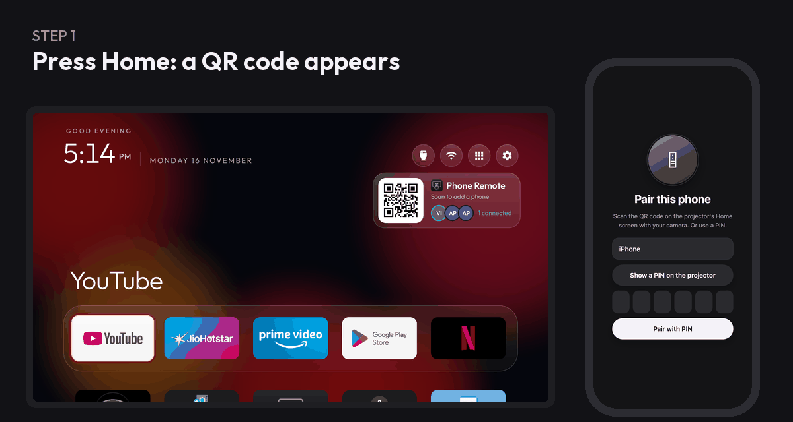
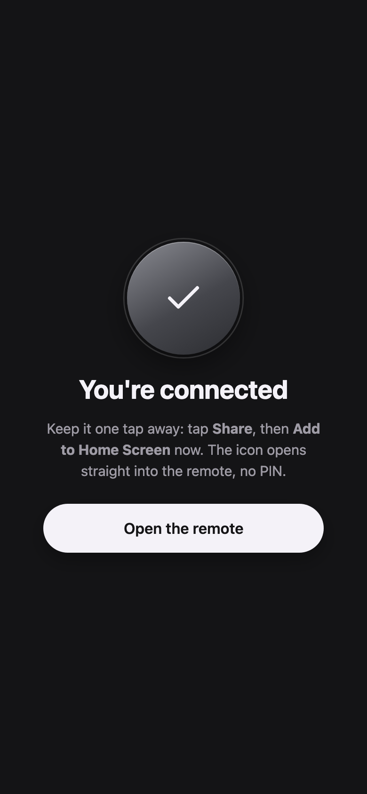
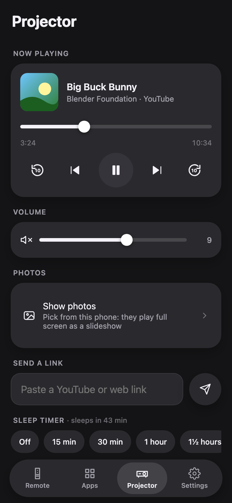
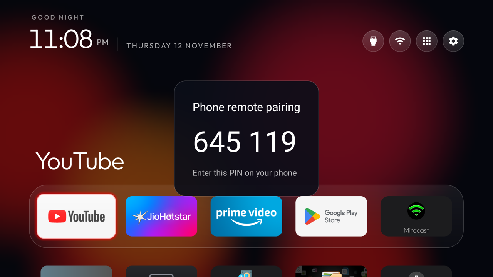

<p align="center"></p>

# Awesome Android TV Phone Remote

**Your phone as the remote for an Android projector or TV.** D-pad, touchpad, volume, media keys, an app launcher,
typing and voice search. Nothing to install on the phone: scan the QR code on the screen, type the PIN it shows,
done. Works on iPhone and Android.

Made for the budget Android projectors and TV boxes that Google's own remote apps cannot find, because they are
not certified Android TV devices. It needs no root and no Google services, and it never leaves your local network.

<p align="center"></p>

<p align="center">
  <a href="https://github.com/vikramkrana/awesome-android-tv-phone-remote/releases/latest/download/phone-remote-tv.apk"></a>
  <a href="#iphone"></a>
  <a href="https://github.com/vikramkrana/awesome-android-tv-phone-remote/releases/latest/download/phone-remote-android.apk"></a>
</p>
<p align="center"><a href="https://github.com/vikramkrana/awesome-android-tv-phone-remote/releases/latest">All downloads and release notes</a></p>

## Get started

You need: an Android projector, TV or TV box (Android 8 or newer), a phone, and both on the **same Wi-Fi**.
It takes about five minutes, once.

### Step 1: Put the app on the projector or TV

Download **[phone-remote-tv.apk](https://github.com/vikramkrana/awesome-android-tv-phone-remote/releases/latest/download/phone-remote-tv.apk)** (under 1 MB) and install it, whichever way is easiest for you:

- **USB stick (easiest):** copy the APK to a USB stick, plug it into the projector, open the projector's
  **File manager** (or *Files*, *Media center*), open the APK and choose **Install**. If it asks, allow installing
  apps from the file manager, then go back and press **Install** again.
- **No computer, no stick:** install the free **Downloader** app (by AFTVnews) from the projector's app store, open
  it and type this address, then press **Go** and **Install**:<br>
  `https://github.com/vikramkrana/awesome-android-tv-phone-remote/releases/latest/download/phone-remote-tv.apk`
- **From a computer with ADB:** `adb connect <projector-ip>:5555`, then `adb install phone-remote-tv.apk`.

### Step 2: Switch it on (once)

1. On the projector, open **Phone Remote** from the apps list.
2. The screen says the remote is off. Select **Turn on** and press OK.
3. Read what it can do and choose **Agree and continue**. Android's **Accessibility** settings open.
4. Choose **Phone Remote**, switch it **on**, and confirm with **Allow** or **OK**.
5. Press **Back**: the app now shows a green **Ready**, and a QR code.

> Switch greyed out ("Restricted setting")? Android 13+ does this for apps installed from a file. Open
> **Settings → Apps → Phone Remote → ⋮ (top right) → Allow restricted settings**, then repeat step 4.
>
> Why accessibility? It is the part of Android that lets an app press Back, Home and the arrow keys for you. The app
> uses it only for that: see [Security](docs/SECURITY.md).

### Step 3: Pair your phone

1. Press **Home** on the projector's remote. A small card with a **QR code** appears at the top right (it is also
   on the Phone Remote app screen).
2. Open the phone's **camera** and point it at the QR code. Tap the link that pops up.

<a id="iphone"></a>**iPhone**

3. Safari opens the pairing screen, and a **6-digit PIN** appears on the big screen. Type it and tap
   **Pair with PIN**.
4. On "You're connected": tap **Share** (the square with the arrow) → **Add to Home Screen** → **Add**. Now the
   remote is an app icon on your iPhone. Open it from there; it asks for a PIN once more, then never again.
5. Optional, **"Hey Siri, Projector"**: in the remote, **Settings → Set up "Hey Siri, Projector" → Add to Siri**,
   then follow the [Siri steps](docs/GUIDE.md#voice-commands-and-siri).

**Android phone**

3. Chrome opens and offers two choices:
   - **Download the app** (recommended): it comes from the projector itself, no store and no account. Open the
     downloaded file, tap **Install** (allow installs from Chrome if asked), then open **Phone Remote**. A PIN appears
     on the big screen: type it.
   - **Use it in the browser:** a PIN appears on the big screen straight away: type it and tap **Pair with PIN**.

That's it: the phone is the remote. Scan the same QR with every phone in the house (up to 5 by default, more in the
app's settings).

<p align="center"></p>

### How it works

- The app on the projector runs a tiny web server on your home network and shows its address as the QR code.
- Your phone opens that page: on iPhone it is a web app, on Android a small app or Chrome. Nothing goes through the
  internet; there is no account and no cloud.
- The PIN on the big screen proves you are in the room; after that the phone is remembered.
- Each press on the phone is sent to the projector, which presses the key for you through Android's accessibility
  service. That's also how it reads the app list, types into search boxes and controls what is playing.

Something not working? See [Troubleshooting](docs/TROUBLESHOOTING.md). Every screen is explained in the
[Guide](docs/GUIDE.md).

## Screens

### On the phone

<p align="center">
  
  
  
  
</p>

### On the projector or TV

<p align="center">
  
</p>
<p align="center">
  
  
</p>

## What it does

| | |
|---|---|
| **Remote** | A metal D-pad with OK, upright volume beside it, Back, Home and mute below. It scales to any phone, from 320 px up to tablets. Arrows and volume repeat while held. Every press gives a visible press and a haptic tick. |
| **Focus** | On projectors with a focus motor (Joyar firmware, e.g. PixPaq): Focus − / + (hold to keep turning) and Auto focus on the remote. |
| **Picture & input** | Where the firmware has them: auto correct (camera focus and keystone), keystone, zoom, input source. |
| **Power and bedtime** | ⏻ opens Screen off / Power off. Bedtime: the screen goes off at the same time every night, after a 5-minute warning on screen. |
| **Show photos** | Pick photos on the phone; they play full screen as a slideshow. Nothing is kept on the device afterwards. |
| **Voice and Siri** | Commands in plain words ("open Netflix", "pause", "volume 30", "search YouTube for…") from a box in Settings, or "Hey Siri, Projector" through an iPhone shortcut with a per-phone key. |
| **Kids phones** | A role set on the device: only the apps a family phone ticks, volume up to 70%, no settings. |
| **Touchpad** | Swipe to move, tap to select, swipe and hold to keep moving, hold still for a long press, two fingers to scroll a page. |
| **Now playing** | Title, artwork, position and seeking, ±10 s, previous/next, for whatever plays on the device. |
| **Send a link** | Paste a YouTube or web link and it opens on the big screen; on Android also from the Share menu. |
| **Sleep timer, volume slider** | Sleep in 15 min to 2 hours; set the volume directly. |
| **Screen preview** | Optional: a small live picture of the screen on family phones (Android 11+). |
| **Guests** | Phones that pair as guests are gone after 24 hours and cannot change settings, sleep the device or see the screen; volume stops at 70%. |
| **Several screens** | Other TVs and projectors with this remote on the same Wi-Fi are listed; one tap switches. |
| **Apps** | Every app on the device with its icon; tap to open it there. Recent apps, four quick apps you choose, and the app that is open now is highlighted. |
| **Typing and voice** | Type or dictate on the phone's keyboard into the search box selected on the screen. |
| **Search YouTube** | Say or type a search; YouTube opens on the results. |
| **Pairing** | A QR card on the Home screen opens the page; a 6-digit PIN on the big screen proves you are in the room. Pair once: the phone is never asked again. |
| **Many phones** | Up to a limit you set (5 by default, up to 20), each with a name and a "connected now" dot. New phones can be switched off. |
| **Android app** | Optional, handed out by the device itself: full screen, finds the device on the Wi-Fi, scans its QR, stays paired when its address changes, the phone's own voice typing. |
| **Private** | Local network only. No account, no cloud, no analytics. |

## Does it work on my device?

| Device | Works? |
|---|---|
| Android **13 or newer** projector, TV or TV box | Yes. Arrows and OK are real key presses. |
| Android **8 to 12** | Should, with a difference: arrows move the focus through accessibility instead of key presses. Fine in menus and launchers; apps that draw their own interface (some games, some players) may not follow. **Not yet tried on a real device: reports welcome.** |
| Android 7 or older, Roku, webOS, Tizen | No. |
| Phone | Any phone with a browser. Haptics on iPhone need iOS 17.4+ and Safari. |

Developed and tested on one device so far: a MediaTek-based 1080p projector running Android 13. Everything that
was specific to it has been replaced by detection or by a setting, see
[compatibility notes](docs/TROUBLESHOOTING.md#compatibility-notes).

## Documentation

- [Guide](docs/GUIDE.md): install, pair, and every screen explained
- [Troubleshooting and compatibility](docs/TROUBLESHOOTING.md)
- [Security](docs/SECURITY.md): what a paired phone can and cannot do, how pairing works
- [Development](docs/DEVELOPMENT.md): how it is built, the HTTP API, settings for other devices, working on the page
  without a device

## Build

JDK 17 and the Android SDK (platform 34).

```sh
echo "sdk.dir=$HOME/Library/Android/sdk" > local.properties   # your SDK path
./gradlew assembleRelease
# app/build/outputs/apk/release/app-release.apk
```

The release build is signed with the debug key so that it can be sideloaded. Use your own key to publish.

## Limits

- The phone and the device must be on the same network, and that network must let devices talk to each other
  (hotel and office Wi-Fi often does not: use the phone's hotspot).
- It can put the device to sleep (Android 9+), but not wake it: asleep, the device no longer hears the phone. Use
  its own remote to switch it on.
- No mouse pointer for apps made for touch screens.
- Maker-specific buttons (keystone, focus, input source) are reached through the device's own settings screen.
- If the device gets a new address, the phone pairs once more. A DHCP reservation in your router avoids that.

## extras/

`cleanyourtv-motion-and-mesh-background.patch` changes the
[cleanyourtv](https://github.com/Gathin23/cleanyourtv) launcher (MIT), the Home screen in the pictures above:
two optional moving backgrounds (a mesh gradient that takes its colours from the focused app, and a slow drift for
wallpaper pictures), a centred screensaver clock with ticking seconds, and proper tiles for phone apps without a
TV banner (the icon's own background fills the tile). Apply it with `git apply` in a
cleanyourtv checkout.

## Releasing

[docs/RELEASE.md](docs/RELEASE.md): GitHub releases and what Google Play needs. Privacy: [PRIVACY.md](PRIVACY.md).

## Credits

Made by Vikram Rana. Contributions and device reports welcome, see [Development](docs/DEVELOPMENT.md#contributing).

## Licenses

- This project: MIT, see [LICENSE](LICENSE)
- Outfit font: SIL Open Font License 1.1, see [FONT-LICENSE-OFL.txt](FONT-LICENSE-OFL.txt)
- [ZXing core](https://github.com/zxing/zxing) (QR codes): Apache License 2.0, fetched by Gradle
