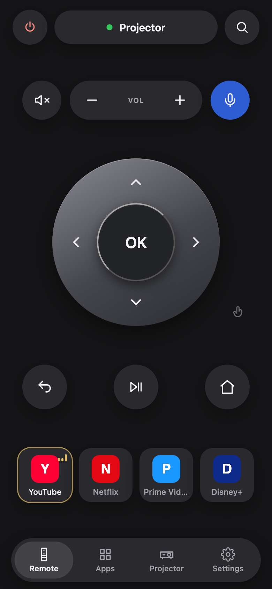
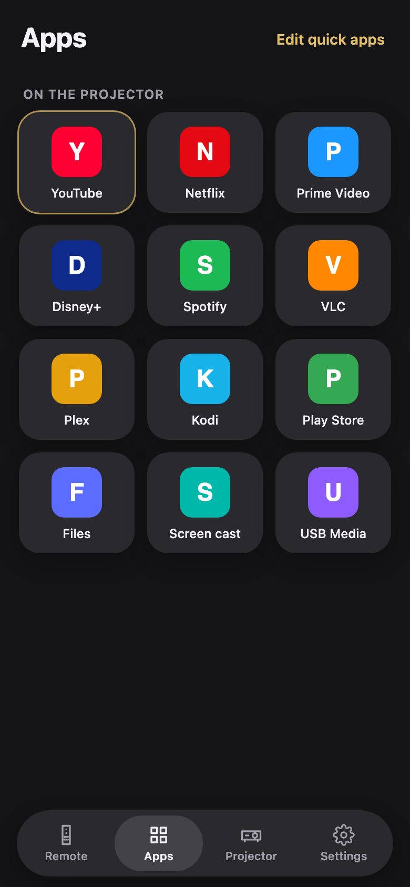
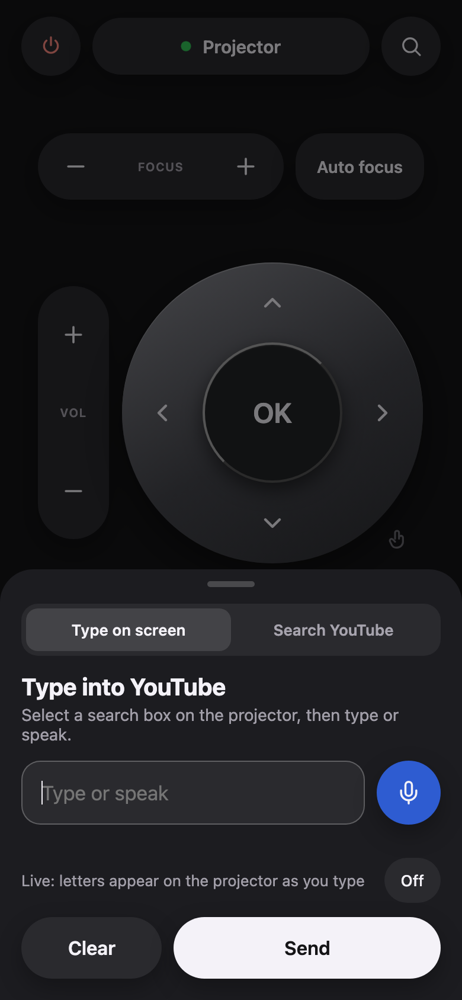
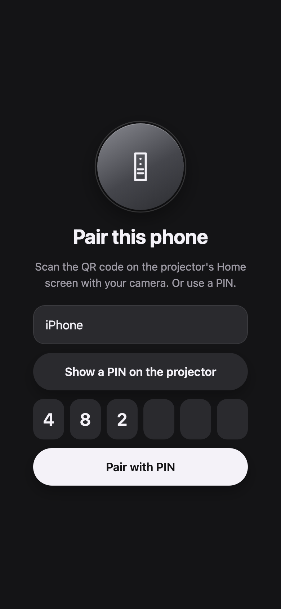
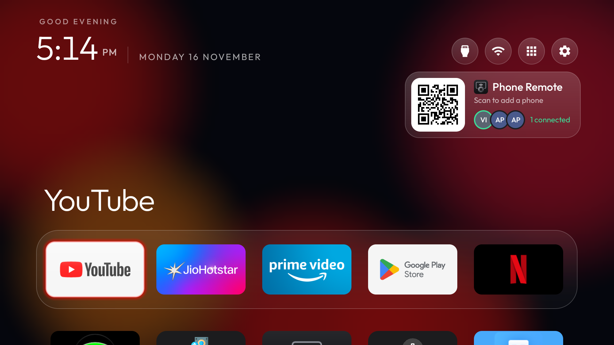

<p align="center"></p>

# Phone Remote

**Your phone as the remote for an Android projector or TV.** D-pad, touchpad, volume, media keys, an app launcher,
typing and voice search. Nothing to install on the phone: scan the QR code on the screen, type the PIN it shows,
done. Works on iPhone and Android.

Made for the budget Android projectors and TV boxes that Google's own remote apps cannot find, because they are
not certified Android TV devices. It needs no root and no Google services, and it never leaves your local network.

<p align="center">
  
  
  
  
</p>
<p align="center"></p>

## What it does

| | |
|---|---|
| **Remote** | A metal D-pad with OK; mute, volume and voice above it; Back, play/pause and Home below. Arrows and volume repeat while held. Every press gives a visible press and a haptic tick. |
| **Touchpad** | Swipe to move, tap to select, swipe and hold to keep moving, hold still for a long press, two fingers to scroll a page. |
| **Now playing** | Title, artwork, position and seeking, ±10 s, previous/next, for whatever plays on the device. |
| **Send a link** | Paste a YouTube or web link and it opens on the big screen; on Android also from the Share menu. |
| **Sleep timer, volume slider** | Sleep in 15 min to 2 hours; set the volume directly. |
| **Screen preview** | Optional: a small live picture of the screen on family phones (Android 11+). |
| **Guests** | Phones that pair as guests are gone after 24 hours and cannot change settings, sleep the device or see the screen; volume stops at 70%. |
| **Several screens** | Other TVs and projectors with this remote on the same Wi-Fi are listed; one tap switches. |
| **Apps** | Every app on the device with its icon; tap to open it there. Recent apps, four quick apps you choose, and the app that is open now is highlighted. |
| **Typing and voice** | Type or dictate on the phone's keyboard into the search box selected on the screen. |
| **Search YouTube** | Say or type a search; YouTube opens on the results. |
| **Pairing** | A QR card on the Home screen opens the page; a 6-digit PIN on the big screen proves you are in the room. Pair once: the phone is never asked again. |
| **Many phones** | Up to a limit you set (5 by default, up to 20), each with a name and a "connected now" dot. New phones can be switched off. |
| **Private** | Local network only. No account, no cloud, no analytics, about 150 KB. |

## Does it work on my device?

| Device | Works? |
|---|---|
| Android **13 or newer** projector, TV or TV box | Yes. Arrows and OK are real key presses. |
| Android **8 to 12** | Should, with a difference: arrows move the focus through accessibility instead of key presses. Fine in menus and launchers; apps that draw their own interface (some games, some players) may not follow. **Not yet tried on a real device: reports welcome.** |
| Android 7 or older, Roku, webOS, Tizen | No. |
| Phone | Any phone with a browser. Haptics on iPhone need iOS 17.4+ and Safari. |

Developed and tested on one device so far: a MediaTek-based 1080p projector running Android 13. Everything that
was specific to it has been replaced by detection or by a setting, see
[compatibility notes](docs/TROUBLESHOOTING.md#compatibility-notes).

## Quick start

0. **Get the APK:** [`dist/phone-remote-1.2.apk`](dist/phone-remote-1.2.apk) (420 KB, debug-signed), or
   [build it](#build).
1. **Install** the APK on the projector or TV, either way:
   - `adb install app-release.apk`, or
   - copy it to a USB stick and open it with the device's file manager.
2. **Open Phone Remote** on the device and choose **Turn on**, read what it allows, then switch **Phone Remote** on.
   (With ADB you can do this from the computer instead, see the [guide](docs/GUIDE.md#2-switch-the-remote-on).)
3. **Press Home.** Scan the QR card with the phone's camera, type the PIN from the big screen.
4. On iPhone: **Share → Add to Home Screen** while "You're connected" is showing. On Android: tap **Download the app** on the "You're connected" screen (or Projector tab → **Get the Android app**). Chrome cannot add a shortcut to a page from a home device, so the projector hands out a small app instead (`phone/`, about 400 KB): full screen, finds the projector on the Wi-Fi by itself, stays paired when its address changes, uses the phone's voice typing, can scan the QR.

The full walk-through, with a picture of every screen: **[docs/GUIDE.md](docs/GUIDE.md)**.

## Documentation

- [Guide](docs/GUIDE.md): install, pair, and every screen explained
- [Troubleshooting and compatibility](docs/TROUBLESHOOTING.md)
- [Security](docs/SECURITY.md): what a paired phone can and cannot do, how pairing works
- [Development](docs/DEVELOPMENT.md): how it is built, the HTTP API, settings for other devices, working on the page
  without a device

## Build

JDK 17 and the Android SDK (platform 34).

```sh
echo "sdk.dir=$HOME/Library/Android/sdk" > local.properties   # your SDK path
./gradlew assembleRelease
# app/build/outputs/apk/release/app-release.apk
```

The release build is signed with the debug key so that it can be sideloaded. Use your own key to publish.

## Limits

- The phone and the device must be on the same network, and that network must let devices talk to each other
  (hotel and office Wi-Fi often does not: use the phone's hotspot).
- It can put the device to sleep (Android 9+), but not wake it: asleep, the device no longer hears the phone. Use
  its own remote to switch it on.
- No mouse pointer for apps made for touch screens.
- Maker-specific buttons (keystone, focus, input source) are reached through the device's own settings screen.
- If the device gets a new address, the phone pairs once more. A DHCP reservation in your router avoids that.

## extras/

`cleanyourtv-motion-and-mesh-background.patch` changes the
[cleanyourtv](https://github.com/Gathin23/cleanyourtv) launcher (MIT), the Home screen in the pictures above:
two optional moving backgrounds (a mesh gradient that takes its colours from the focused app, and a slow drift for
wallpaper pictures), a centred screensaver clock with ticking seconds, and proper tiles for phone apps without a
TV banner (the icon's own background fills the tile). Apply it with `git apply` in a
cleanyourtv checkout.

## Releasing

[docs/RELEASE.md](docs/RELEASE.md): GitHub releases and what Google Play needs. Privacy: [PRIVACY.md](PRIVACY.md).

## Credits

Made by Vikram Rana. Contributions and device reports welcome, see [Development](docs/DEVELOPMENT.md#contributing).

## Licenses

- This project: MIT, see [LICENSE](LICENSE)
- Outfit font: SIL Open Font License 1.1, see [FONT-LICENSE-OFL.txt](FONT-LICENSE-OFL.txt)
- [ZXing core](https://github.com/zxing/zxing) (QR codes): Apache License 2.0, fetched by Gradle
