# Guide

From a fresh APK to a working remote, then every screen in turn.

- [1. Install on the projector or TV](#1-install-on-the-projector-or-tv)
- [2. Switch the remote on](#2-switch-the-remote-on)
- [3. Pair a phone](#3-pair-a-phone)
- [4. Keep it on the phone's Home Screen](#4-keep-it-on-the-phones-home-screen)
- [5. The screens on the phone](#5-the-screens-on-the-phone)
- [6. The screens on the projector or TV](#6-the-screens-on-the-projector-or-tv)
- [7. Several TVs and projectors](#7-several-tvs-and-projectors)
- [8. More phones, removing phones](#8-more-phones-removing-phones)

## 1. Install on the projector or TV

Pick one.

**With a USB stick (no computer needed afterwards)**

1. Copy `app-release.apk` to a USB stick and plug it into the device.
2. Open the device's file manager, open the APK, allow installing from that app if asked.

**With ADB**

1. On the device, turn on USB debugging (Settings → About → press *Build* seven times → Developer options).
   Some firmwares hide Developer options. For the first install use the USB stick instead; once Phone Remote is
   installed, its screen has a **Developer options** row for later updates.
2. From a computer on the same network:

```sh
adb connect <device-ip>:5555
adb install -r app-release.apk
```

## 2. Switch the remote on

Phone Remote works as an Android **accessibility service**: that is the part of Android that lets an app press Back,
Home and the arrow keys for you. It has to be switched on once.

**On the device:** open **Phone Remote** from the apps list. While the remote is off, the screen says so in red and
offers **Turn on**. Press OK: a screen explains what the remote can and cannot do. Choose **Agree and continue**,
then in Android's Accessibility settings choose **Phone Remote**, switch it on, confirm.

> **"Restricted setting"** (Android 13+, only for apps installed from a file): if the switch is greyed out, open
> Settings → Apps → Phone Remote → the ⋮ menu → **Allow restricted settings**, then try again. Installing with ADB
> avoids this.

**Or with ADB:**

```sh
# Keep the services that are already on: read the current value first.
adb shell cmd settings get secure enabled_accessibility_services
adb shell cmd settings put secure enabled_accessibility_services \
  '<existing services>:com.local.projremote/com.local.projremote.RemoteService'
```

If the first command prints `null`, leave out `<existing services>:`.

**Remote off again after a restart?** A few projector firmwares reset this switch at every boot. One more ADB
command lets the app switch itself back on from then on (details in
[Security](SECURITY.md#permissions)):

```sh
adb shell pm grant com.local.projremote android.permission.WRITE_SECURE_SETTINGS
```

> **Turn USB debugging off again when you are done.** On many cheap projectors, network ADB needs no password
> and gives full control of the device to anyone on the Wi-Fi.

## 3. Pair a phone

The phone must be on the same Wi-Fi as the device.

**1. Press Home on the device.** A small card with a QR code appears.

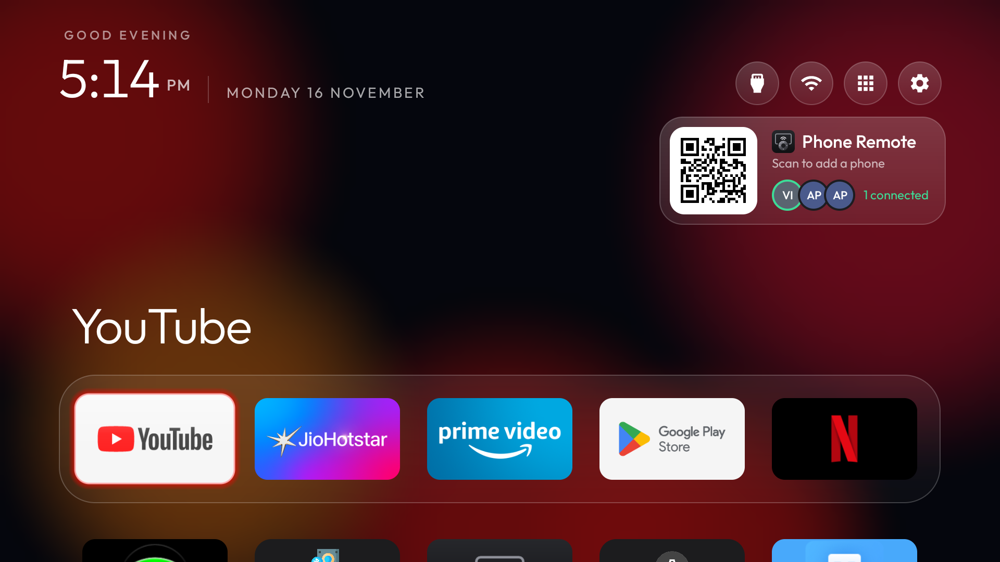

**2. Scan the QR code with the phone's camera** and open the link. The phone shows the pairing screen, and at the
same moment a PIN appears on the big screen.

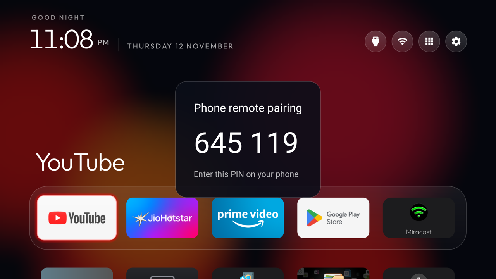

**3. Type the six digits on the phone**, check the phone's name, tap **Pair with PIN**.

<p>
  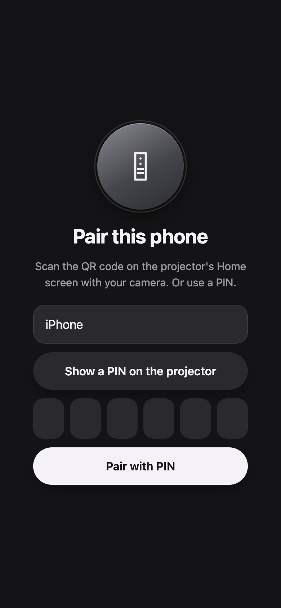
  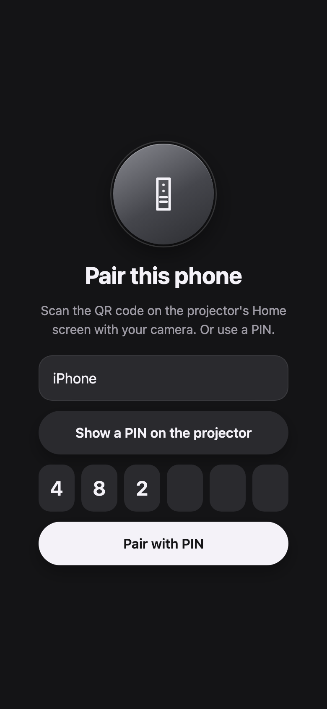
  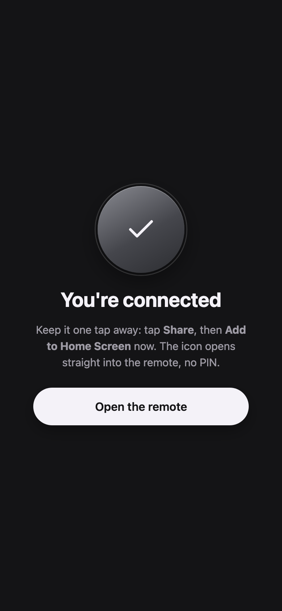
</p>

The PIN is valid for two minutes and for five tries. **Show a new PIN** gives another one.

No QR card? Open **Phone Remote** on the device: the same QR code is there, with the address written out below it.

## 4. Keep it on the phone's Home Screen

**iPhone:** while **You're connected** is on screen, tap **Share**, then **Add to Home Screen**. The icon opens the
remote full screen, with no PIN. If you skipped that moment: **Settings → Add to Home Screen** in the remote does
the same later.

*Why "while that screen is showing"?* On iPhone a Home Screen icon has storage of its own, separate from Safari.
During that screen the address carries a single-use code, which the new icon trades for its own key the first
time it opens.

**Android:** in Chrome, ⋮ → **Add to Home screen**.

After pairing, the phone is not asked for a PIN again: not when you scan the QR another time, and not when the
browser has cleared its saved data.

## 5. The screens on the phone

### Remote

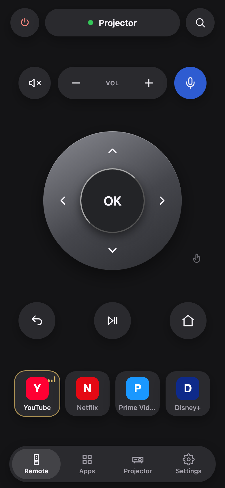

| Control | Does |
|---|---|
| ⏻ (top left) | Sleep: tap twice. Wake the device with its own remote. |
| Name pill (top) | Green dot = connected. Tap for the Projector/TV tab; with more than one device on the Wi-Fi, a list to switch between them. |
| 🔍 | Type into the open app, or search YouTube from Home. Switch between the two in the sheet. |
| 🔇 · **− VOL +** · 🎤 | Mute, volume (hold to keep changing), speak. |
| Ring | Up, down, left, right: the whole quarter of the ring counts. Hold to repeat. **OK** in the middle. |
| ☝ (beside the ring) | Switch between the ring and the touchpad. |
| ↩ · ⏯ · ⌂ | Back, play/pause, Home. |
| Bottom row | Your four quick apps, icon and name. The one that is open now has a gold outline. |

Rewind and forward, all apps and the device's settings moved to the Projector/TV and Apps tabs.

<br clear="right">

### Touchpad

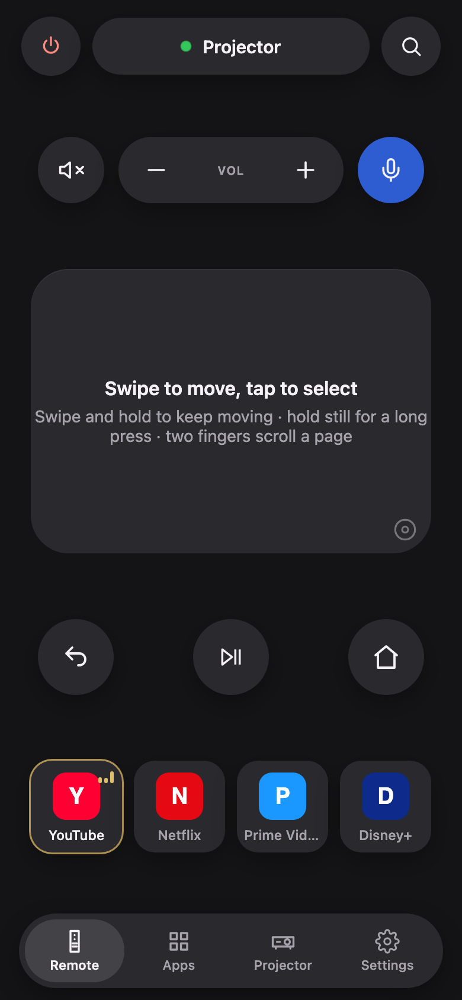

Swipe in a direction to move one step; keep the finger down after a swipe to keep moving; tap to select. Hold a
finger still for a long press (menus, "move this tile"); swipe with two fingers to scroll a page. It moves the
selection like the ring does. It is not a mouse pointer.

<br clear="right">

### Apps

<p>
  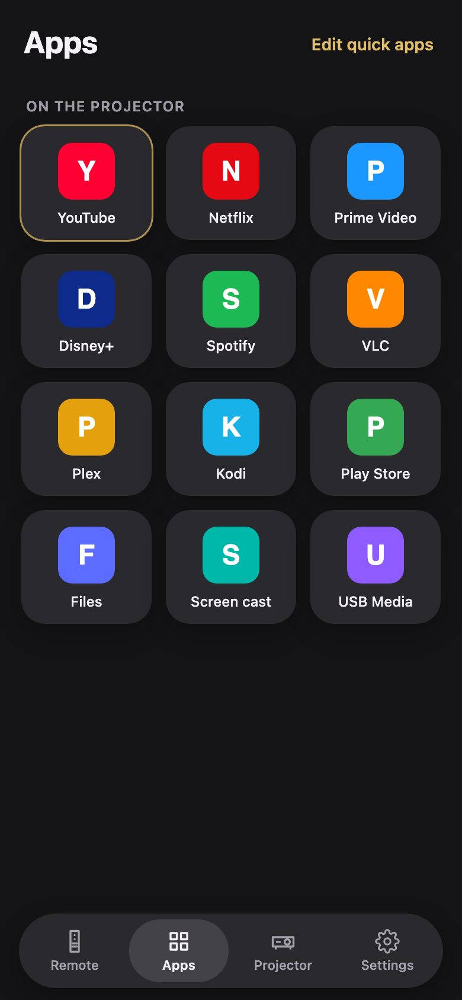
  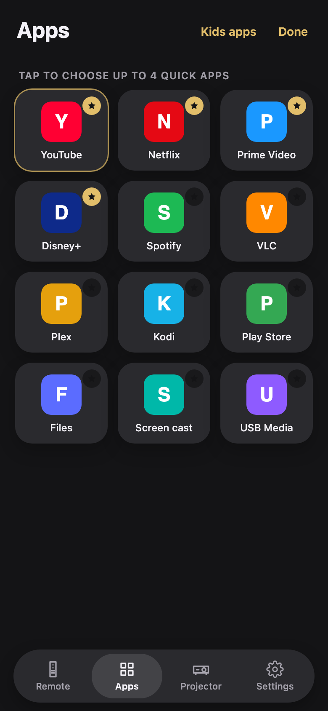
</p>

Tap an app to open it on the big screen. **Recent** appears once you have opened some. **Edit quick apps** lets
you star up to four for the row under the ring on the Remote tab. Home screens, system settings and factory
tools are left out on purpose.

### Typing, voice and YouTube search

<p>
  
  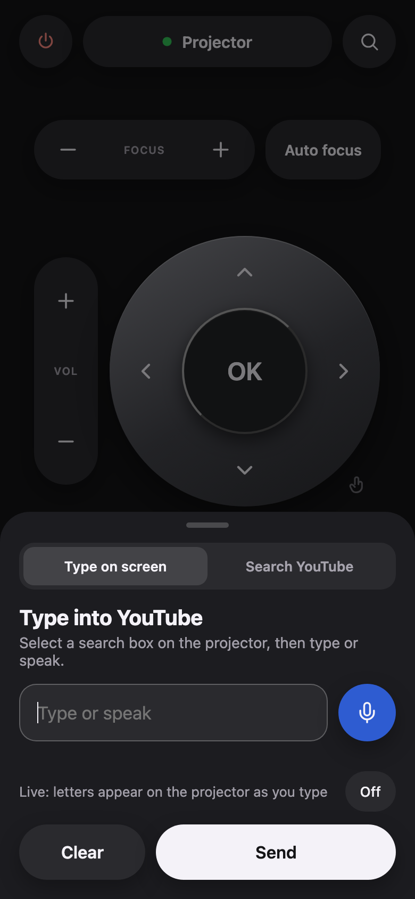
</p>

- **Type on screen:** first select a search or text box on the big screen, then type on the phone and tap
  **Send**. The text replaces what is in the box and the keyboard's Enter is pressed for you.
- **Voice:** tap the microphone on the phone's own keyboard and speak. The phone does the speech recognition.
- **Search YouTube:** opens YouTube on the big screen with the results. Earlier searches are kept as chips.
  Typed text is never kept (it might be a password).

### Projector / TV

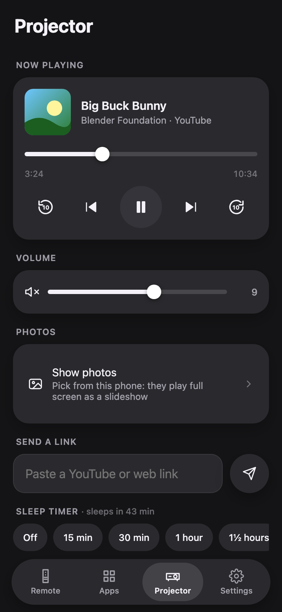

- **Now playing:** title, artist, app and artwork of what plays on the device, a position bar you can drag, ±10 s,
  previous, play/pause, next. Needs **Now playing** switched on on the device (see section 6); until then the card
  shows which app is open.
- **On screen:** a small live picture of the big screen, about once a second, when the owner has switched on
  **Screen preview** (Android 11+). Not for guests. Protected video shows black.
- **Volume:** a slider, for jumping straight to a level.
- **Send a link:** paste a YouTube, Netflix, Prime Video or any web link; it opens in the matching app on the big
  screen. On Android, after adding the remote to the Home screen, **Share → (this remote)** in any app does the same.
- **Sleep timer:** 15 minutes to 2 hours; the label shows the time left. **Off** cancels.
- **Shortcuts:** the device's own settings (picture, sound, network; focus and keystone on projectors) and Home.
- **Other screens here:** other TVs and projectors with this remote on the same Wi-Fi. Tap one to switch; each
  pairs the phone once, on its own.

<br clear="right">

### Settings

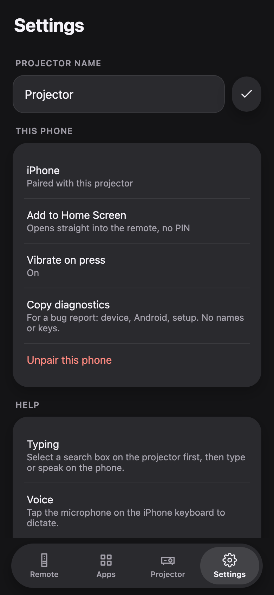

- **Name:** what phones call this device. Below it, the device's own web address (e.g.
  `http://living-room-3f2a.local:8080`), which also works on most phones on the same Wi-Fi.
- **Add to Home Screen** (iPhone in Safari): see step 4.
- **Vibrate on press:** the haptic tick.
- **Copy diagnostics:** device, Android version and setup, for a bug report. No names, keys or screen content.
- **Unpair this phone:** removes it on the device too.

<br clear="right">

### When something is off

<p>
  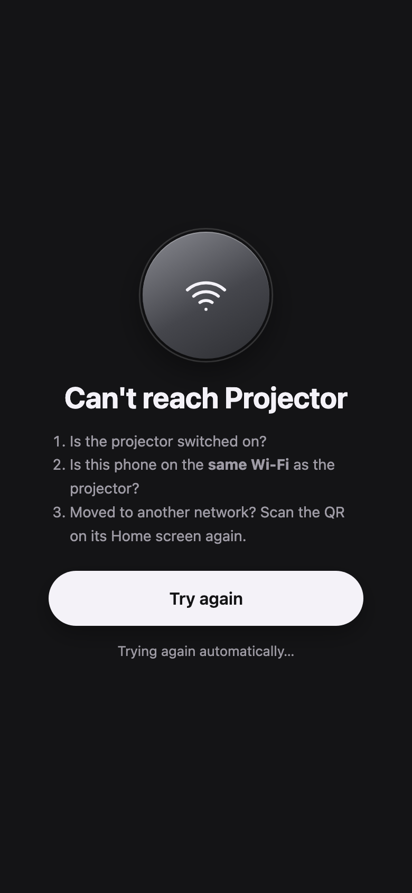
  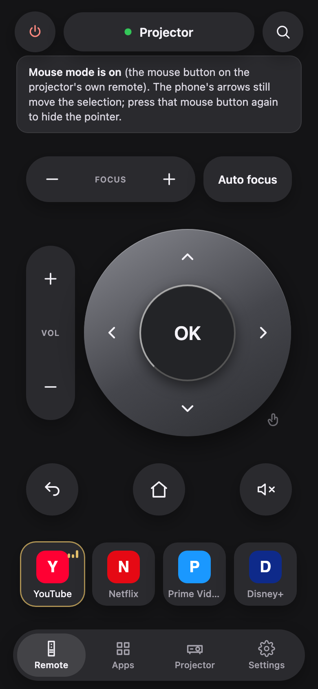
</p>

- **Guest:** a note at the top of Settings says how long the phone stays paired, and the controls a guest cannot
  use are hidden.

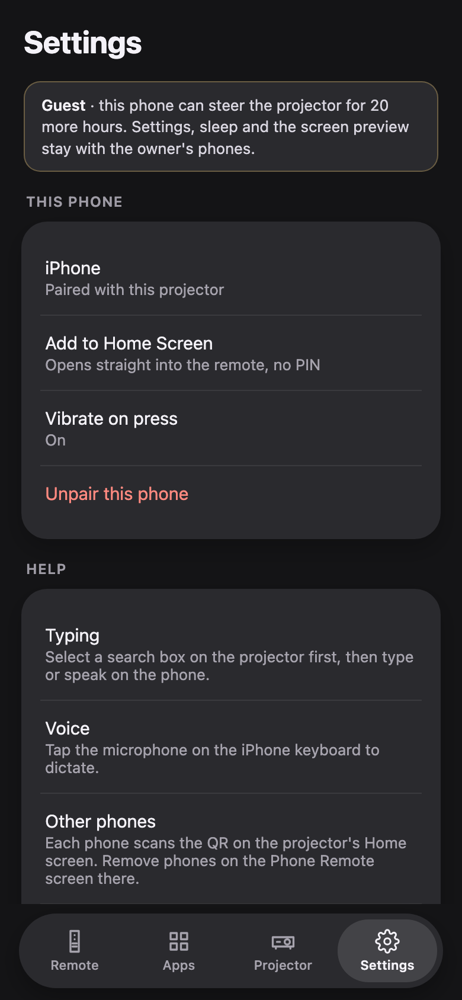

- **Can't reach …:** the device is off or on another network. The page keeps trying and comes back by itself.
- **Mouse mode is on:** some projector remotes have a mouse button that turns arrow keys into a pointer. The
  phone's arrows keep working; press that button again to hide the pointer.

## 6. The screens on the projector or TV

**The Home card** (picture in step 3): the QR code, and a chip for each paired phone, green while that phone is
connected. It hides itself when something on the Home screen would be under it. Click it with a pointer (the
remote's mouse mode, an air mouse, or a touchscreen) to open the Phone Remote screen. The arrow keys cannot select
it: it would have to take them away from the Home screen to do that.

**The Phone Remote screen:** open **Phone Remote** from the apps list.

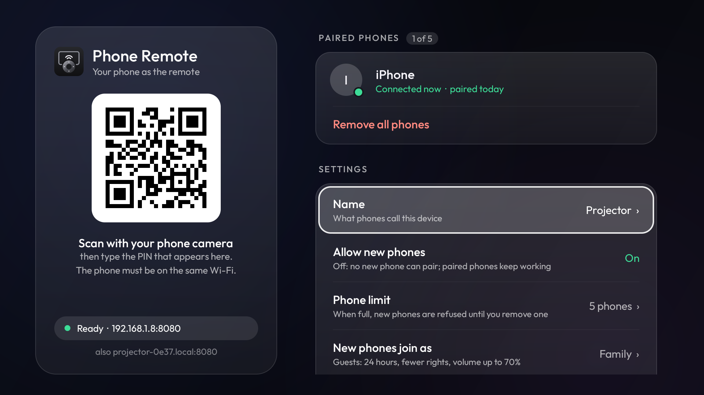

Left: the QR code, how to pair, and whether the remote is ready (green), waiting for the network (amber) or off
(red, with **Turn on**). Right, from top to bottom:

- **Paired phones**, one card: green dot and "Connected now", or when last used; guests show the hours they have
  left. **OK** on a phone: make it a guest or family, or remove it. **Remove all phones** at the end: OK twice.
- **Name:** what phones call this device. A text box opens; type with the on-screen keyboard, or from a paired
  phone with **Type on screen**. Also changes the `.local` address.
- **Allow new phones:** turn it off once your phones are paired; nobody else can pair until you turn it back on.
  Paired phones keep working.
- **Phone limit:** 1, 2, 3, 4, 5 (the default), 10 or 20 phones. When it is reached, new phones are refused until
  you remove one; no paired phone is ever pushed out.
- **New phones join as:** family (default) or guests. Guests are removed after 24 hours, cannot open the device's
  settings, rename it, sleep it, set the sleep timer, see the screen preview or copy diagnostics, and their volume
  stops at 70%.
- **QR card on Home:** press OK to move the card to another corner, or turn it off.
- **This device is a:** projector or TV. Only changes the wording on the phone.
- **Show when phones connect:** a short note on the big screen when a phone pairs or comes back.
- **Now playing** (on the phones): needs Android's *notification access* for Phone Remote, which is only used to
  see which app plays what. OK opens Android's **Notification access** screen. Projectors that hide it: from a
  computer, `adb shell cmd notification allow_listener com.local.projremote/com.local.projremote.MediaListener`.
- **Screen preview:** off by default. On: family phones see a small live picture of the screen (Android 11+).
- **Check for updates:** shown when the build has a GitHub `project_url`. Off by default; once a day it asks
  GitHub for a newer release and shows it here and on the phones.
- **Accessibility**, **Developer options:** Android's own screens, to switch the remote off, or USB debugging on and
  off.
- **Diagnostics:** the same report the phones can copy.
- **About:** version, credits, licences.

## 7. Several TVs and projectors

Install the app on each one. On the same Wi-Fi they find each other: tap the name pill at the top of the Remote
tab and pick a screen. The first time on each device, pair with that device's PIN; after that switching asks
nothing. Each device keeps its own phones, guests and limit.

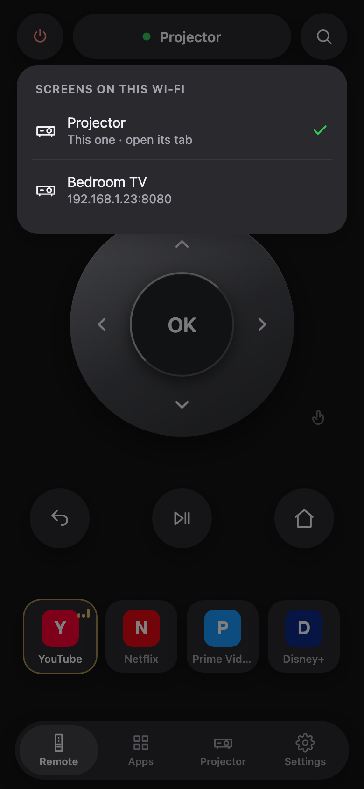

On iPhone, a Home Screen icon belongs to one device: add one per device ("Living room", "Bedroom"). Switching from
inside an icon opens the other device in a Safari sheet. Networks that block Bonjour (many guest networks) do not
list the other devices; scanning that device's QR works anyway.

## 8. More phones, removing phones

- **Another phone:** scan the same QR code. Each phone gets its own name ("iPhone", "iPhone 2", …). Up to the
  **Phone limit** (5 unless you change it). When it is reached, the Home card and the Phone Remote screen say
  *Full*, and a phone that scans the code is told the projector is full instead of being offered a PIN. No PIN
  appears on the big screen, and no paired phone is removed to make room.
- **Remove one:** on the Phone Remote screen, select it, OK, **Remove**.
- **Visitors:** select a phone, OK, **Make guest**; or set **New phones join as → Guests** before they pair.
- **Remove all:** **Remove all phones**, OK twice.
- A removed phone sees the pairing screen the next time it opens the remote.
